<div align="center">

# ☀️ Renewable Energy Forecasting & Solar Power Analytics Dashboard

### An interactive dashboard for exploring renewable-energy data, comparing prediction approaches, and visualizing solar power plant performance.

<p>
  
  
  
  
  
  
</p>

**[🌐 Live Demo](https://thezohaibkhan.github.io/renewable-energy-dashboard/)** ·
**[📦 Repository](https://github.com/TheZohaibKhan/renewable-energy-dashboard)**

</div>

---

## 📑 Table of Contents

- [1. Project Overview](#-1-project-overview)
- [2. Problem Statement](#-2-problem-statement)
- [3. Project Objectives](#-3-project-objectives)
- [4. Key Features](#-4-key-features)
- [5. Application Modules](#-5-application-modules)
- [6. System Architecture](#-6-system-architecture)
- [7. Application Workflow](#-7-application-workflow)
- [8. Renewable-Energy Data Workflow](#-8-renewable-energy-data-workflow)
- [9. Solar Power Plant Workflow](#-9-solar-power-plant-workflow)
- [10. Prediction Approaches](#-10-prediction-approaches)
- [11. Metrics and Visualizations](#-11-metrics-and-visualizations)
- [12. Technology Stack](#-12-technology-stack)
- [13. Project Structure](#-13-project-structure)
- [14. Installation and Setup](#-14-installation-and-setup)
- [15. Running the Application](#-15-running-the-application)
- [16. Using the Renewable-Energy Dashboard](#-16-using-the-renewable-energy-dashboard)
- [17. Using the Solar Power Plant Dashboard](#-17-using-the-solar-power-plant-dashboard)
- [18. Input Data Guidelines](#-18-input-data-guidelines)
- [19. Model Implementation Notes](#-19-model-implementation-notes)
- [20. GitHub Pages Demo](#-20-github-pages-demo)
- [21. Deployment Notes](#-21-deployment-notes)
- [22. Troubleshooting](#-22-troubleshooting)
- [23. Limitations and Responsible Interpretation](#-23-limitations-and-responsible-interpretation)
- [24. Future Enhancements](#-24-future-enhancements)
- [25. Contributing](#-25-contributing)
- [26. License](#-26-license)
- [27. Author and Project Links](#-27-author-and-project-links)

---

## 🌍 1. Project Overview

The **Renewable Energy Forecasting & Solar Power Analytics Dashboard** is a web-based data exploration project built with **Next.js, React, TypeScript, and Chart.js**. It provides a guided interface for uploading energy datasets, processing numeric observations in the browser, comparing several prediction-style algorithms, and visualizing the resulting values.

The application provides two analysis paths:

1. **Renewable Energy Analysis** — accepts CSV and Excel files, extracts a solar-energy series, optionally derives a weather adjustment from available weather columns, and compares generated prediction series.
2. **Solar Power Plant Analysis** — accepts plant-level records containing timestamps, source/inverter identifiers, DC power, AC power, daily yield, and total yield. It aggregates AC power by row and visualizes power/yield summaries.

The interface is designed around a workflow: select an analysis path, upload a dataset, view a processing screen, and inspect the resulting dashboard. Users can change the selected prediction approach and chart type without uploading the file again.

> **Important:** The current repository implements its prediction approaches with custom TypeScript calculations and heuristics. The labels PCA, Random Forest, and RNN are used by the interface, but the current code does not train or load fitted scikit-learn, TensorFlow, or PyTorch models. Treat the outputs as exploratory demo predictions, not validated engineering forecasts.

### Live Preview

**[Open the Renewable Energy Dashboard Demo](https://thezohaibkhan.github.io/renewable-energy-dashboard/)**

The GitHub Pages demo is a separate static HTML showcase. It is not the full Next.js application and does not run the TypeScript code from the main project.

---

## 🎯 2. Problem Statement

Renewable-energy observations can be difficult to interpret when they are stored in spreadsheets or CSV files. Analysts may need to inspect production patterns, compare actual values with an estimated series, and understand how solar-plant metrics vary across records.

This project explores a user-friendly interface for that workflow. It combines file upload, browser-side parsing, heuristic prediction calculations, metric summaries, and interactive charts in one application.

### Why this project?

- Energy datasets often arrive as tabular CSV or Excel files.
- Raw values are easier to investigate when displayed visually.
- Comparing multiple calculation approaches can help users explore different smoothed or trend-adjusted series.
- Solar power plant records can contain separate DC power, AC power, daily yield, and total yield fields that benefit from summary views.
- A guided UI makes the analysis workflow easier to demonstrate and explain.

---

## 🎯 3. Project Objectives

- Build a responsive web interface for renewable-energy and solar-plant data exploration.
- Support CSV and Excel upload paths in the browser.
- Extract numeric solar-energy values from renewable-energy files.
- Read common solar-plant columns such as `DC_POWER`, `AC_POWER`, `DAILY_YIELD`, and `TOTAL_YIELD`.
- Generate and compare three heuristic prediction series exposed in the interface as PCA, Random Forest, and RNN.
- Apply a simple weather-based adjustment to renewable-energy predictions when supported weather columns are present.
- Visualize actual and predicted values with line, bar, scatter, and histogram-style charts where available.
- Display summary metrics, including MAE, RMSE, R², and a derived accuracy percentage in the renewable dashboard.
- Keep the analysis flow understandable through dedicated home, upload, processing, and dashboard screens.
- Provide a public static demonstration page through GitHub Pages.

---

## ✨ 4. Key Features

### 📁 Data Upload and Parsing

- Upload CSV (`.csv`), Excel 97–2003 (`.xls`), and Excel workbook (`.xlsx`) files in the main application.
- Use a dedicated upload screen for renewable-energy data.
- Use a dedicated upload screen for solar power plant data.
- Download a sample solar-energy CSV from the renewable upload screen.
- Display an error message when solar file parsing fails or the selected file is empty.
- Parse supported data in the browser; no application-specific server API is configured in the provided source.

### ⚡ Renewable-Energy Dashboard

- Extract a numeric solar-energy series from recognized column names.
- Generate three prediction series using the project's TypeScript routines.
- Use weather columns, when available, to calculate an adjustment factor.
- Compare original observations and the selected prediction series.
- Switch the selected model and chart type.
- Review summary values such as estimated lifetime, degradation, yield, accuracy, MAE, and R².

### ☀️ Solar Power Plant Dashboard

- Read timestamps and source/inverter labels when supplied.
- Read DC power, AC power, daily yield, and total yield fields.
- Aggregate AC power across sources for the prediction series.
- Compare predicted values using the selected approach.
- View summary cards for DC power, AC power, average daily yield, and model accuracy.
- Switch chart type and prediction approach.

### 📊 Visualization

The main dashboard exposes these chart choices:

| Chart type | Purpose |
|---|---|
| Line | Observe value movement across record order |
| Bar | Compare values across records or bins |
| Scatter | Compare actual and predicted values point by point |
| Histogram | Inspect value-frequency distribution |

Chart availability and the exact datasets displayed vary by dashboard section.

### 🎛️ Interactive Navigation

- Switch between **Renewable Energy** and **Solar Power Plant** modes on the home screen.
- Move through home, upload, processing, and dashboard states.
- Select PCA, Random Forest, or RNN in the dashboard.
- Change chart types.
- Upload another dataset to reset the current analysis.

---

## 🧩 5. Application Modules

| Module | File | Responsibility |
|---|---|---|
| Main application | `app/page.tsx` | Maintains selected dataset type, current view, parsed data, selected model, and selected chart type |
| Home screen | `components/home-section.tsx` | Introduces the selected analysis path and starts the workflow |
| Renewable upload | `components/upload-section.tsx` | Reads renewable-energy files, extracts values, computes prediction series, and passes parsed data to the app |
| Solar upload | `components/solar-upload-section.tsx` | Parses solar-plant records and builds solar data and predictions |
| Processing screen | `components/processing-section.tsx` | Shows a processing state while the app transitions to the dashboard |
| Renewable dashboard | `components/dashboard-section.tsx` | Calculates summary metrics and renders renewable charts |
| Solar dashboard | `components/solar-dashboard-section.tsx` | Summarizes solar power and yield and renders solar charts |
| Prediction routines | `lib/ml-models.ts` | Contains PCA-style, Random-Forest-style, RNN-style, linear-regression, weather-adjustment, and metric helper functions |
| Shared UI | `components/ui/` | Reusable interface components such as cards, tabs, buttons, and select controls |
| Global styling | `app/globals.css` | Global styles and theme configuration |
| Root layout | `app/layout.tsx` | Defines document metadata, fonts, global CSS, and Vercel Analytics |

---

## 🏗️ 6. System Architecture

The provided application is a **client-side Next.js application**. The main page owns the workflow state and passes uploaded data to the appropriate dashboard component. The prediction calculations are implemented in `lib/ml-models.ts`.

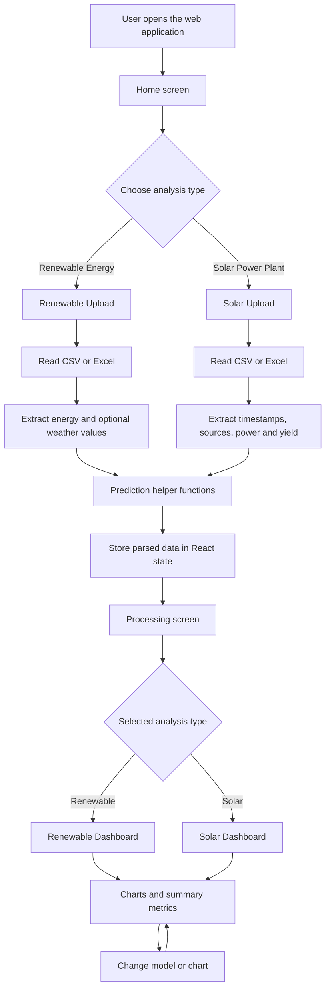

### Architecture explanation

1. **Presentation layer:** React components render the home screen, upload forms, processing state, and dashboards.
2. **State management:** `app/page.tsx` uses React state to remember the selected analysis path, current view, parsed data, model, and chart type.
3. **File-processing layer:** Upload components read and parse user-selected tabular files in the browser.
4. **Prediction layer:** `lib/ml-models.ts` creates prediction-style numeric series using custom TypeScript calculations.
5. **Visualization layer:** Chart.js renders the renewable dashboard charts; the solar dashboard also uses Chart.js.
6. **Summary layer:** Helper calculations derive the displayed metrics from original and predicted arrays.

### Data flow between components

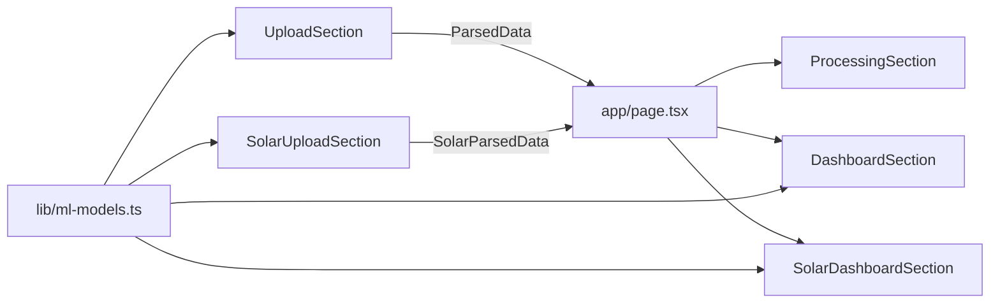

---

## 🔄 7. Application Workflow

The application follows a guided state transition:

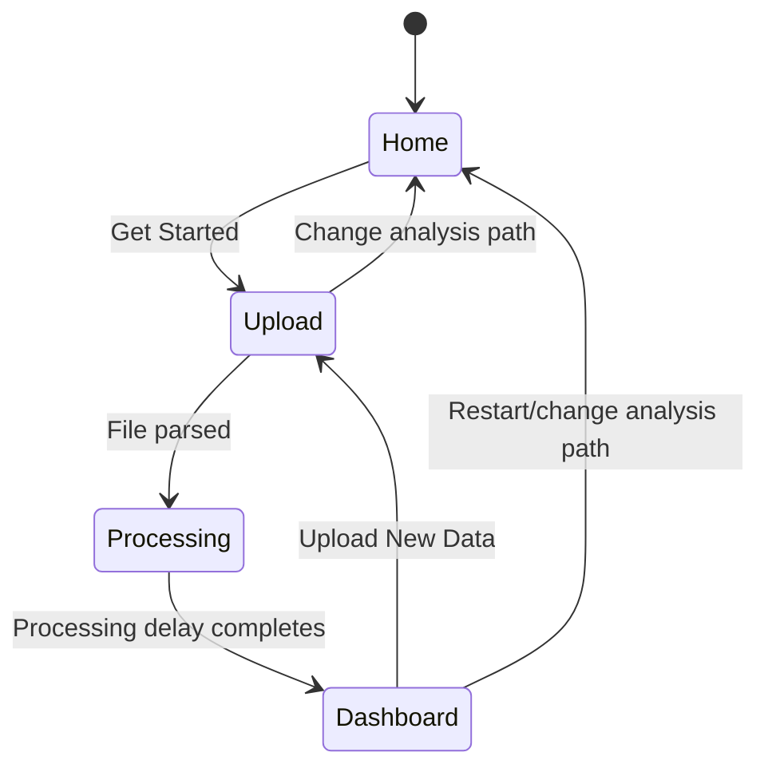

### Workflow details

1. The user opens the home screen.
2. The user chooses Renewable Energy or Solar Power Plant.
3. The user selects a CSV or Excel file.
4. The upload component parses the file and prepares numeric arrays.
5. The app generates its prediction series.
6. The parsed data is stored in React state.
7. The processing screen is displayed briefly.
8. The relevant dashboard is rendered.
9. The user changes the prediction method or chart type to explore the results.
10. The user can upload another file to start a new analysis.

---

## 🌱 8. Renewable-Energy Data Workflow

The renewable upload component looks for a solar-energy field using names such as `Solar energy`, `solar_energy`, or `energy`. The component also checks supported weather fields when building a weather adjustment.

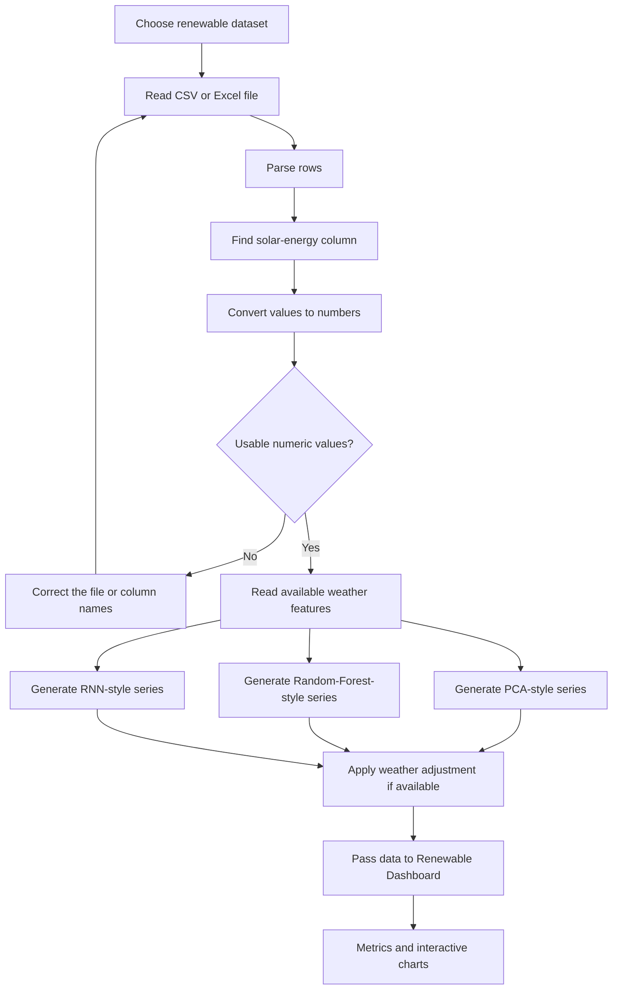

### Weather features

The helper supports the following optional numeric feature arrays:

- Temperature
- Humidity
- Cloud cover
- Visibility
- Wind speed

The weather adjustment helper normalizes available feature values, computes a multiplicative adjustment, and clamps the result to a factor between `0.6` and `1.4`. The exact adjustment is a heuristic encoded in the project; it is not a trained meteorological model.

### Renewable-energy data flow

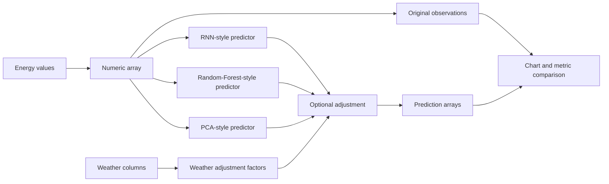

---

## ☀️ 9. Solar Power Plant Workflow

The solar upload component reads solar plant records and prepares arrays for timestamps, source identifiers, DC power, AC power, daily yield, and total yield. It aggregates AC power across available sources for the prediction series.

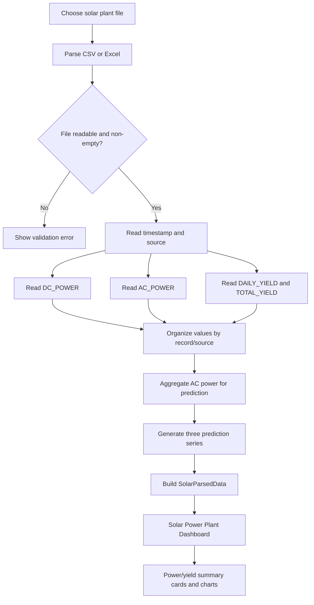

### Recognized solar fields

| Field | Description |
|---|---|
| `DATE_TIME` / timestamp-like field | Date/time associated with a record, when present |
| `SOURCE_KEY` / source-like field | Source or inverter identifier, when present |
| `DC_POWER` | Direct-current power value |
| `AC_POWER` | Alternating-current power value |
| `DAILY_YIELD` | Daily energy yield value |
| `TOTAL_YIELD` | Cumulative energy yield value |

Column names and casing should match the parsing logic in the source. If your source dataset uses different column names, adapt the parsing logic before relying on the output.

### Solar data processing

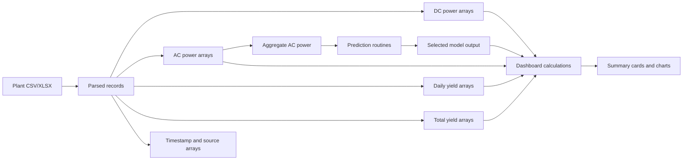

---

## 🧠 10. Prediction Approaches

The interface exposes three approaches:

- **PCA** — Principal Component Analysis, as named in the user interface.
- **Random Forest** — displayed in the source using the internal key `Rainforest`.
- **RNN** — Recurrent Neural Network, as named in the user interface.

### Implementation in the current repository

| UI option | Source function | Current implementation behavior |
|---|---|---|
| PCA | `pcaPredict()` | Uses local-window means, a simple trend term, non-negative clipping, and optional sampling/interpolation |
| Random Forest | `randomForestPredict()` | Combines multiple rule-based series using local means, trend, volatility, and a weekly-style adjustment |
| RNN | `rnnPredict()` | Uses exponential moving average, momentum, and a three-point smoothing pass |
| Linear regression helper | `linearRegressionPredict()` | Fits a simple least-squares line to the sequence with deterministic small noise |
| Weather adjustment | `computeWeatherAdjustment()` | Computes a bounded multiplier from optional weather feature arrays |
| Adjustment application | `applyAdjustment()` | Multiplies a base prediction series by adjustment factors and clamps outputs to non-negative values |

### Prediction comparison workflow

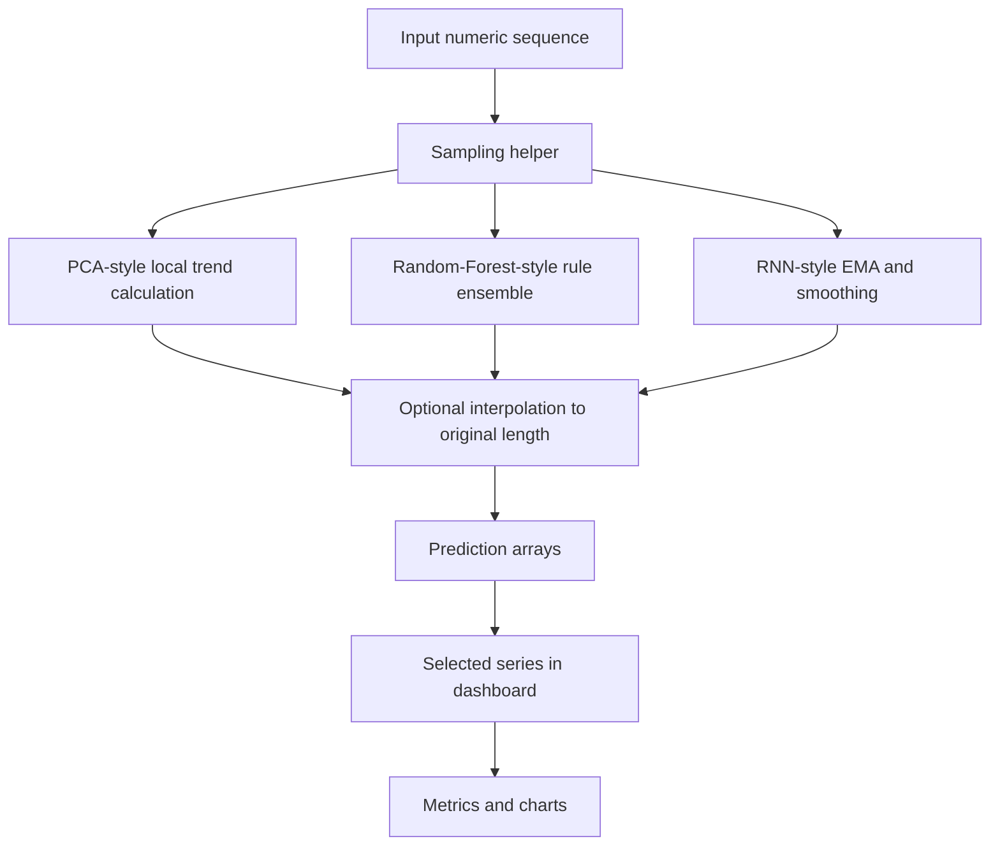

### Why the terminology matters

The names are useful for demonstrating the UI's model-selection workflow, but they should not be interpreted as evidence of standard trained ML implementations:

- The PCA routine does not perform a conventional fitted principal-component decomposition.
- The Random Forest routine does not train a forest of decision trees from labeled training examples; it computes an ensemble of hand-written rules.
- The RNN routine does not load or train a recurrent neural network; it calculates an exponential moving average, momentum, and smoothing.

For research or operational forecasting, replace these routines with validated models, appropriate train/test splits, documented features, and reproducible evaluation.

---

## 📈 11. Metrics and Visualizations

### Renewable dashboard metrics

The renewable dashboard calculates metrics from the original and selected predicted sequences.

| Metric | Meaning |
|---|---|
| MAE | Mean absolute difference between actual and predicted values |
| RMSE | Square root of the mean squared prediction error |
| R² | Coefficient of determination calculated from the actual and predicted series |
| Accuracy percentage | A project-specific derived percentage based on MAE and the mean of the actual series |
| Estimated lifetime | A display estimate derived from the average selected prediction |
| Degradation | A display value currently generated using a random range |
| Yield | A derived total based on the average predicted value, sequence length, and a fixed scaling factor |

**Interpretation warning:** The lifetime, degradation, and yield cards are derived demo calculations. In particular, degradation currently uses a random value and should not be used as a real plant estimate. The accuracy percentage is not a universally accepted forecasting metric and can be misleading depending on the data.

### Solar dashboard metrics

The solar dashboard displays summary cards for:

- Total DC power
- Total AC power
- Average daily yield
- Model accuracy

It derives prediction-related values from the selected prediction series and uses scaling assumptions in the component. Verify units and the source data's sampling frequency before using these summaries for engineering decisions.

### Chart choices

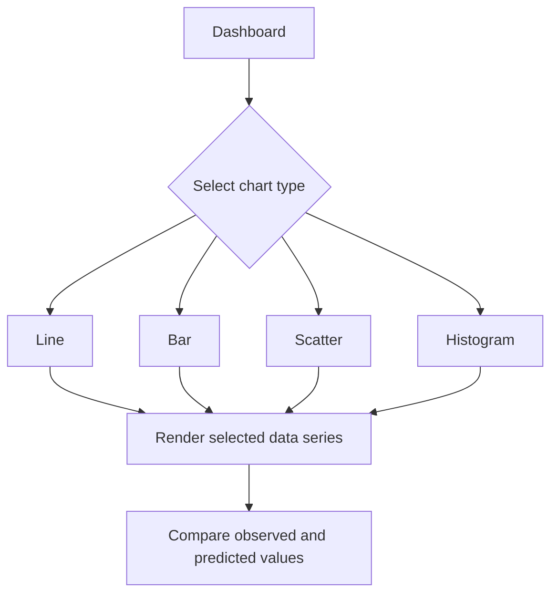

---

## 🧰 12. Technology Stack

### Core technologies

| Technology | Role |
|---|---|
| Next.js 15 | React framework and development/build tooling |
| React 19 | Component-based UI and state management |
| TypeScript 5 | Typed application code |
| Tailwind CSS 4 | Utility-first styling |
| Chart.js | Interactive charts |
| Lucide React | Icons |
| Radix UI | Accessible UI primitives used by shared components |
| Recharts | Charting dependency available in the project |
| XLSX | Spreadsheet file parsing support |
| Vercel Analytics | Analytics integration included in the root layout |
| Geist | Sans-serif and monospace fonts |

### Development tools

- Node.js (use a version compatible with the installed Next.js version)
- npm
- Visual Studio Code or another TypeScript editor
- Git and GitHub

---

## 📂 13. Project Structure

```text
renewable-energy-dashboard/
│
├── app/
│   ├── globals.css                 # Global styles and theme
│   ├── layout.tsx                  # Root layout, metadata, fonts, analytics
│   └── page.tsx                    # Main workflow and React state
│
├── components/
│   ├── home-section.tsx            # Home screen and entry point
│   ├── upload-section.tsx           # Renewable-energy file upload and parsing
│   ├── solar-upload-section.tsx     # Solar plant file upload and parsing
│   ├── processing-section.tsx       # Processing/loading state
│   ├── dashboard-section.tsx        # Renewable dashboard, metrics, charts
│   ├── solar-dashboard-section.tsx   # Solar plant dashboard
│   ├── theme-provider.tsx            # Theme integration
│   └── ui/                           # Shared UI components
│
├── hooks/
│   ├── use-mobile.ts
│   └── use-toast.ts
│
├── lib/
│   ├── ml-models.ts                 # Prediction and metric helper functions
│   └── utils.ts                     # Shared utilities
│
├── public/                          # Static assets, if present
├── styles/                          # Additional styles, if present
├── docs/
│   └── index.html                   # Separate static GitHub Pages showcase
│
├── components.json                  # UI component configuration
├── next.config.*                    # Next.js configuration, if present
├── package.json                     # Scripts and dependencies
├── package-lock.json                # npm dependency lock file, if present
├── tsconfig.json                    # TypeScript configuration
├── postcss.config.*                 # PostCSS configuration, if present
└── README.md
```

The exact file list can vary with repository changes. The `docs/index.html` page is a separate static demo and does not replace the Next.js application source.

---

## 💻 14. Installation and Setup

### Prerequisites

Install the following before running the project:

- Node.js and npm
- Git (optional, for cloning)
- A code editor such as Visual Studio Code

Check your installed versions:

```bash
node --version
npm --version
git --version
```

### Clone the repository

```bash
git clone https://github.com/TheZohaibKhan/renewable-energy-dashboard.git
cd renewable-energy-dashboard
```

If you downloaded the project as a ZIP, extract it and open the extracted project folder in your terminal.

### Install dependencies

```bash
npm install
```

This installs the packages listed in `package.json`, including Next.js, React, Chart.js, XLSX, Tailwind CSS, and the shared UI dependencies.

### Check the project scripts

The current `package.json` defines these scripts:

```json
{
  "scripts": {
    "dev": "next dev",
    "build": "next build",
    "start": "next start",
    "lint": "next lint"
  }
}
```

Depending on the installed Next.js version, `next lint` may no longer be supported. If that script fails, use the lint command configured for your installed Next.js/ESLint setup. The development and build commands remain the primary local checks.

---

## ▶️ 15. Running the Application

### Start the development server

```bash
npm run dev
```

Open:

```text
http://localhost:3000
```

### Create a production build

```bash
npm run build
```

### Run the production server locally

After a successful build:

```bash
npm run start
```

Open `http://localhost:3000` in your browser.

### Typical local workflow

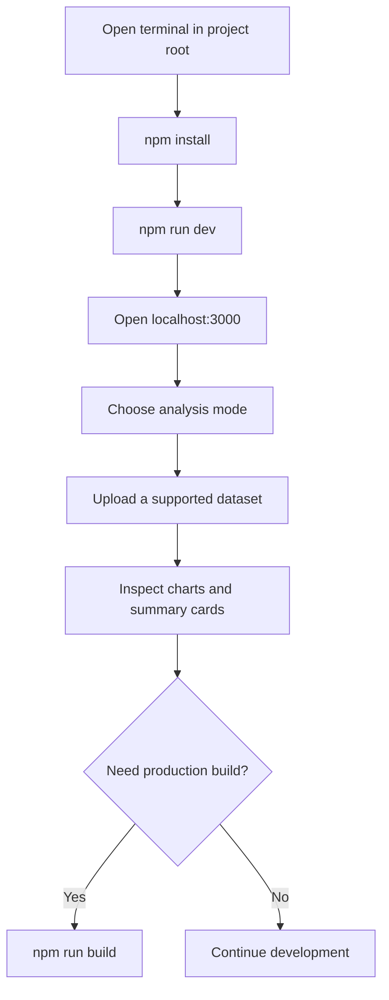

---

## 🌱 16. Using the Renewable-Energy Dashboard

1. Open the application.
2. Choose **Renewable Energy** on the home-screen selector.
3. Select **Get Started**.
4. Upload a CSV or Excel dataset.
5. Ensure the file contains a recognized energy column, such as `Solar energy`, `solar_energy`, or `energy`.
6. Include optional numeric weather columns if you want the weather-adjustment helper to use them.
7. Wait for the processing screen to complete.
8. Choose PCA, Random Forest, or RNN from the model selector.
9. Change the chart type to inspect the series in different ways.
10. Review MAE, RMSE, R², and the other summary cards with the limitations described above.
11. Use **Upload New Data** to start a fresh analysis.

### Example CSV layout

```csv
Date,Solar energy,Temperature,Humidity,Cloud cover,Visibility,Wind speed
2026-01-01,120.5,27,45,0.10,9,3.2
2026-01-02,135.8,29,42,0.05,10,2.8
2026-01-03,110.2,25,60,0.35,7,4.1
2026-01-04,145.0,30,40,0.08,9,3.0
```

This is an illustrative format only. Confirm the exact column names and parsing behavior in `components/upload-section.tsx` before using your own file.

---

## ☀️ 17. Using the Solar Power Plant Dashboard

1. Open the home screen.
2. Select **Solar Power Plant**.
3. Select **Get Started**.
4. Upload a CSV or Excel file containing plant records.
5. Ensure the file includes the expected power and yield columns.
6. Allow the app to parse timestamps, sources, DC power, AC power, daily yield, and total yield.
7. Review the solar dashboard.
8. Change the selected prediction approach and chart type.
9. Review the power and yield cards.
10. Select **Upload New Data** to analyze a different file.

### Example solar plant CSV layout

```csv
DATE_TIME,SOURCE_KEY,DC_POWER,AC_POWER,DAILY_YIELD,TOTAL_YIELD
2026-01-01 08:00:00,INV_01,350.2,332.1,12.4,15230.7
2026-01-01 09:00:00,INV_01,520.6,494.8,25.7,15244.0
2026-01-01 10:00:00,INV_02,610.4,580.2,38.1,16102.3
2026-01-01 11:00:00,INV_02,690.7,655.9,51.6,16115.8
```

This example demonstrates the general column layout; it is not a guarantee that every alternate column naming scheme will be recognized.

---

## 🗃️ 18. Input Data Guidelines

For reliable parsing and meaningful charts:

- Use a consistent header row.
- Keep numeric fields numeric; avoid values such as `500 kW` in a numeric cell unless the parser explicitly handles that format.
- Avoid blank or malformed values in the primary energy/power field.
- Use a consistent unit for each numeric column.
- Keep timestamps in a consistent format.
- For solar plant data, confirm whether records represent individual inverters, time intervals, or aggregated plant output.
- Avoid mixing energy units and power units in the same column.
- Review the first several parsed values and resulting chart before drawing conclusions.

### File processing path

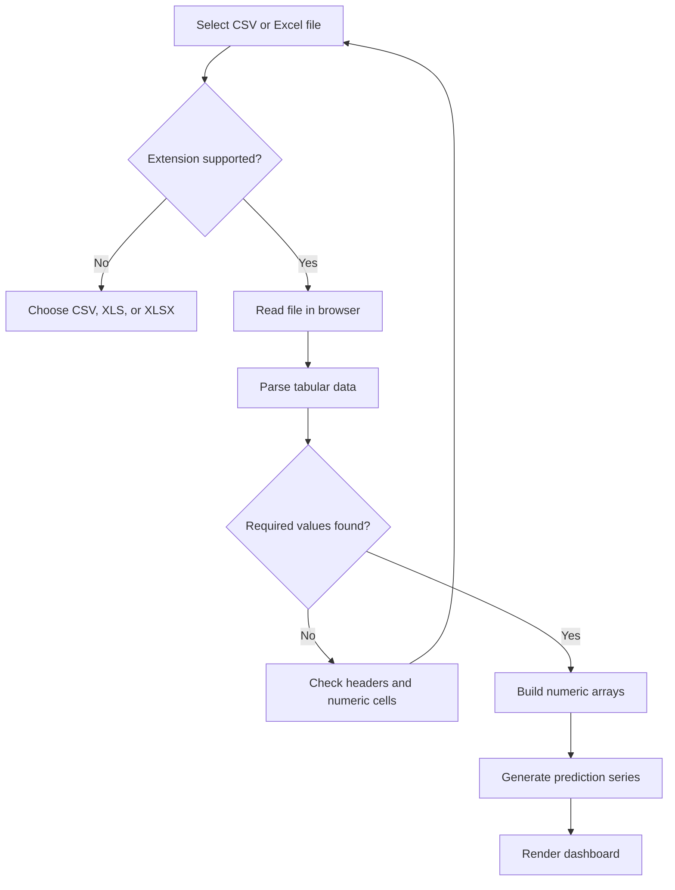

---

## 🔬 19. Model Implementation Notes

### Sampling and interpolation

The model helper file includes sampling and interpolation helpers to manage the number of points processed. When the data is sampled, the helper can interpolate the output back to the original sequence length.

### PCA-style predictor

The current `pcaPredict()` function:

1. Returns the original sequence when it contains fewer than three values.
2. Samples the sequence if necessary.
3. Calculates the mean and standard deviation.
4. Uses a smoothing fallback when the sequence variance is very low.
5. Calculates local-window averages.
6. Estimates a simple local trend.
7. Combines the local average and trend.
8. Clips negative results to zero.
9. Interpolates predictions if sampling reduced the sequence length.

### Random-Forest-style predictor

The current `randomForestPredict()` function:

1. Samples the input sequence.
2. Creates ten rule-based prediction series.
3. Varies the local window size between trees.
4. Calculates local mean, trend, and volatility.
5. Applies hand-written trend and volatility rules.
6. Adds a periodic adjustment when enough points are available.
7. Averages the ten rule-based outputs.
8. Interpolates the result when required.

### RNN-style predictor

The current `rnnPredict()` function:

1. Returns a copy of very short sequences.
2. Samples the sequence if required.
3. Calculates an exponential moving average with a fixed smoothing factor.
4. Calculates a simple momentum term.
5. Combines the smoothed value, current value, and momentum.
6. Applies a three-point smoothing pass.
7. Interpolates back to the original length when needed.

### Metric calculations

`calculateMetrics(actual, predicted)` computes:

- Mean absolute error (MAE)
- Root mean squared error (RMSE)
- R²
- A derived accuracy percentage

The metric helper uses the overlapping length of the two input arrays. If the actual sequence has no variance, R² may be undefined or non-finite. If arrays are empty, metric calculations should be guarded before use.

### Suggested improvement path for real forecasting

For a research-grade model pipeline, consider:

1. Define a target variable and prediction horizon.
2. Validate schema and units.
3. Split records chronologically into train, validation, and test sets.
4. Fit preprocessing only on training data.
5. Train a genuine baseline and ML model.
6. Tune parameters using validation data.
7. Evaluate on an untouched test set.
8. Compare against persistence and seasonal baselines.
9. Report MAE, RMSE, bias, and R² with units and dataset details.
10. Save model versions and document reproducibility.

---

## 🌐 20. GitHub Pages Demo

The repository package includes a separate static showcase at:

```text
docs/index.html
```

The expected project-page URL is:

**[https://thezohaibkhan.github.io/renewable-energy-dashboard/](https://thezohaibkhan.github.io/renewable-energy-dashboard/)**

### Publish the static demo

1. Commit `docs/index.html` to the root of the GitHub repository.
2. Open the repository on GitHub.
3. Go to **Settings → Pages**.
4. Under **Build and deployment**, set **Source** to **Deploy from a branch**.
5. Select branch `main`.
6. Select folder `/docs`.
7. Click **Save**.
8. Open the repository's **Actions** tab and wait for the Pages deployment to succeed.
9. Open the URL shown in the Pages settings.

### GitHub Pages publishing flow

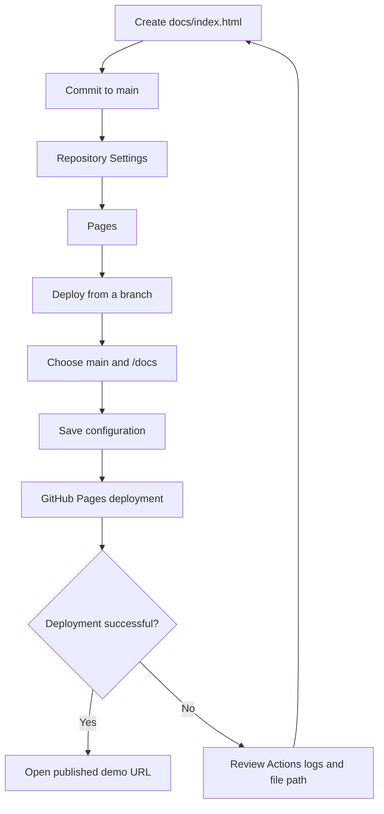

### Important distinction: static demo vs. full Next.js app

GitHub Pages serves static files. The provided `docs/index.html` showcase is static and can be published from `/docs`.

The full application in this repository is a Next.js project that uses React components, client-side file parsing, Chart.js, and TypeScript. Publishing the full Next.js application on GitHub Pages requires a compatible static-export configuration and checking that all routes and assets work under the repository base path. The existing project configuration should be reviewed before attempting that deployment. Do not assume that choosing `/docs` publishes the full Next.js app.

---

## 🚀 21. Deployment Notes

### Option A — GitHub Pages for the static showcase

Use the `docs/index.html` file and the GitHub Pages steps above. This is suitable for a lightweight project demo.

### Option B — Host the full Next.js application

Use a host that supports Next.js, such as Vercel or another Node.js-compatible platform.

General deployment steps:

1. Push the project to GitHub.
2. Import the repository into the hosting platform.
3. Set the project root directory correctly.
4. Use `npm install` for dependency installation.
5. Use `npm run build` for the build command.
6. Configure environment variables only if the application requires them.
7. Deploy and verify the upload and dashboard workflows.

The provided source includes Vercel Analytics, but the app does not show a custom backend API in the inspected workflow. Verify hosting requirements and analytics configuration in your deployment environment.

---

## 🛠️ 22. Troubleshooting

| Problem | Possible reason | What to check |
|---|---|---|
| `npm install` fails | Unsupported Node.js version, network issue, or lockfile mismatch | Check Node/npm versions and rerun installation |
| Development server will not start | Dependencies are missing or port 3000 is already in use | Install dependencies or use the alternate port suggested by Next.js |
| File is not accepted | Unsupported extension or browser parsing error | Use `.csv`, `.xls`, or `.xlsx` and confirm the file is valid |
| Dashboard has no useful values | Required headers are absent or numeric values are empty | Check the expected column names and values |
| Predictions look too smooth | Current routines use smoothing and rule-based calculations | Review `lib/ml-models.ts`; these are not trained forecasting models |
| Solar totals look unexpected | Source aggregation, sampling interval, or units differ | Check source granularity and units before interpreting totals |
| GitHub Pages shows 404 | Pages has not deployed, wrong folder/branch, or missing `index.html` | Check Settings → Pages, Actions, and `docs/index.html` |
| Static demo loads but full app does not | `/docs` publishes only the static showcase | Deploy the Next.js app separately or configure static export |
| Build fails on lint script | `next lint` may not be available in the installed Next.js version | Use the lint setup supported by the installed version |
| Charts do not render as expected | Data may be empty, malformed, or too large | Test with a small valid dataset and inspect browser console errors |

### Debugging checklist

- [ ] Confirm you are in the project root.
- [ ] Confirm `package.json` exists.
- [ ] Run `npm install`.
- [ ] Run `npm run dev`.
- [ ] Test with a small, known-good CSV.
- [ ] Verify required column names.
- [ ] Check browser developer-console errors.
- [ ] For Pages, verify that `docs/index.html` is committed.
- [ ] For deployment failures, inspect the GitHub Actions log.

---

## ⚠️ 23. Limitations and Responsible Interpretation

- The current prediction functions are heuristic TypeScript calculations, not trained production ML models.
- The names PCA, Random Forest, and RNN describe UI options and the intended comparison concept; they do not mean that standard implementations of those algorithms are trained in this code.
- Displayed lifetime and degradation values should not be treated as validated equipment estimates.
- The weather adjustment is a simplified multiplier, not a physical solar-generation model.
- The solar dashboard's calculated metrics depend on the units, sampling interval, and aggregation structure of the uploaded dataset.
- CSV and Excel files are parsed in the browser; large files may use significant memory.
- The static GitHub Pages demo is separate from the full Next.js application.
- Do not use these demo outputs as the sole basis for grid operations, financial decisions, equipment maintenance, or safety-critical planning.

---

## 🧭 24. Future Enhancements

Potential future improvements include:

- Replace heuristic prediction routines with trained and versioned ML models.
- Add schema validation and a clear column-mapping interface.
- Add missing-value handling and outlier detection.
- Add date-aware train/test splitting and leakage prevention.
- Add a forecast horizon selector.
- Add baselines and model evaluation reports.
- Add confidence intervals or prediction intervals.
- Add data export for charts, metrics, and predictions.
- Add downloadable processed CSV output.
- Improve solar source/inverter comparison and time aggregation.
- Add configurable units and conversion.
- Add test coverage for parsing, prediction helpers, and metric functions.
- Add accessibility and automated browser tests.
- Add a backend only if persistent storage, authentication, or server-side model inference is required.

---

## 🤝 25. Contributing

Contributions and suggestions are welcome.

1. Fork the repository.
2. Create a feature branch.
3. Make a focused change.
4. Run the application locally and test the affected workflow.
5. Confirm the build succeeds.
6. Commit your changes with a descriptive message.
7. Open a pull request explaining the change and its testing.

Example:

```bash
git checkout -b feature/improve-data-validation
git add .
git commit -m "Improve renewable dataset validation"
git push origin feature/improve-data-validation
```

---

## 📄 26. License

No license file was identified in the supplied project files. Unless a license is added to the repository, do not assume that the code is released under an open-source license. Add a `LICENSE` file with the license you intend to use.

---

## 👨‍💻 27. Author and Project Links

- **GitHub profile:** [TheZohaibKhan](https://github.com/TheZohaibKhan)
- **Repository:** [Renewable Energy Dashboard](https://github.com/TheZohaibKhan/renewable-energy-dashboard)
- **Static demo:** [Open Live Demo](https://thezohaibkhan.github.io/renewable-energy-dashboard/)

---

<div align="center">

### ☀️ Explore the data. Compare the patterns. Make energy insights easier to understand.

**If this project is useful to you, consider giving the repository a ⭐ on GitHub.**

</div>
